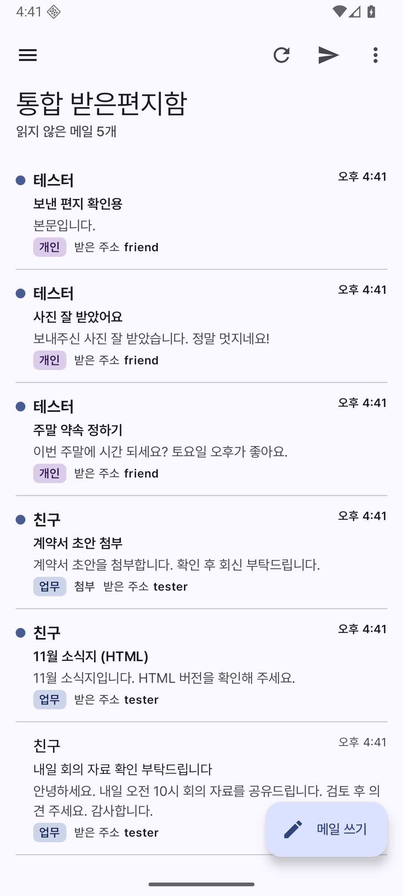
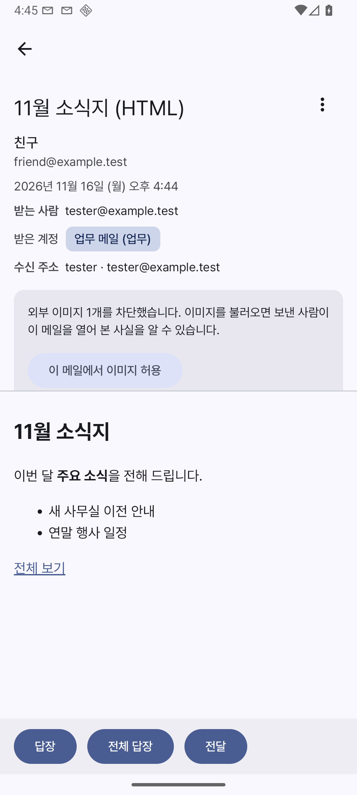
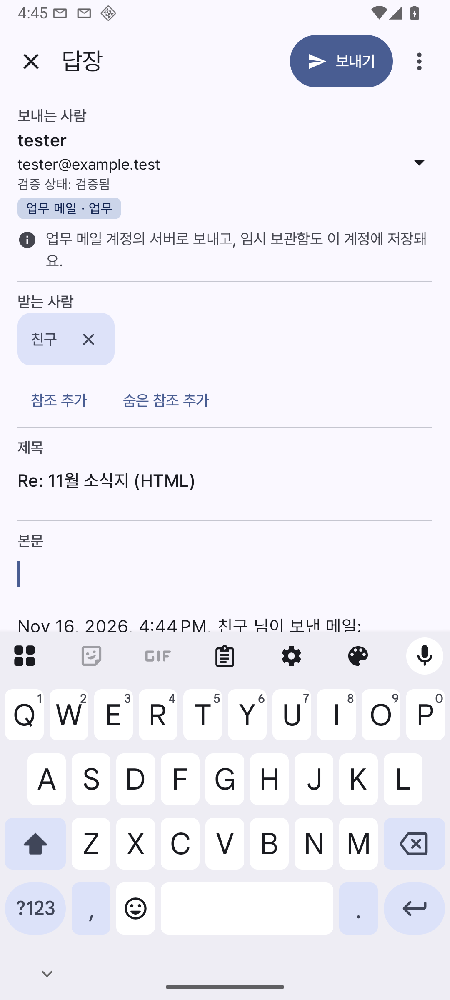
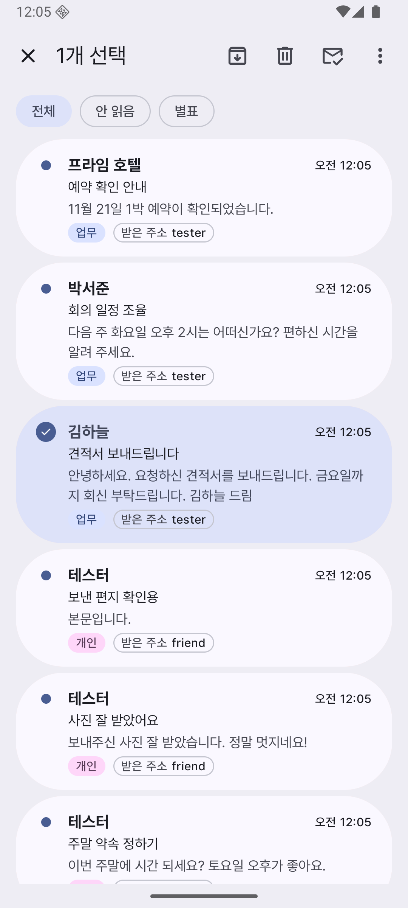
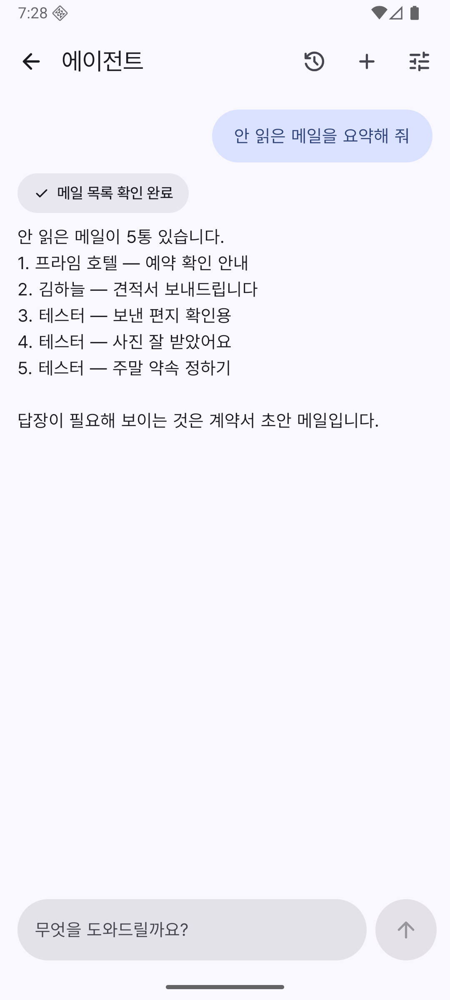
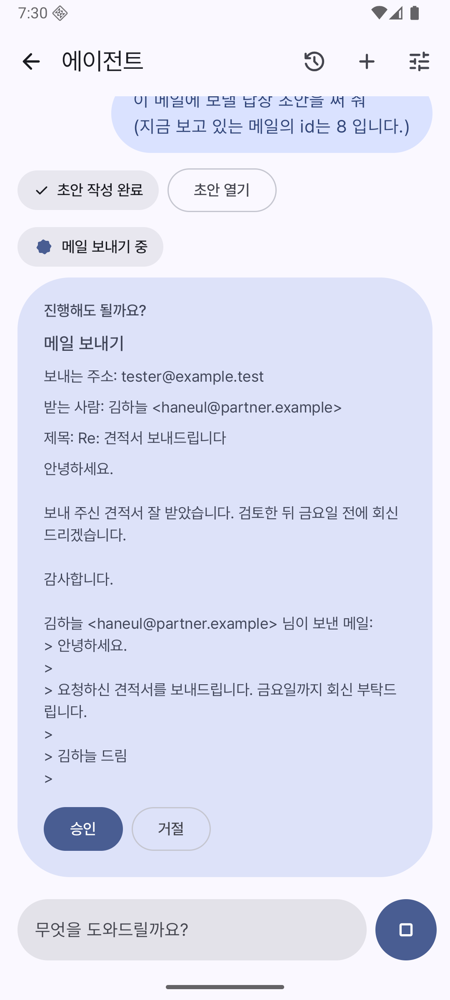
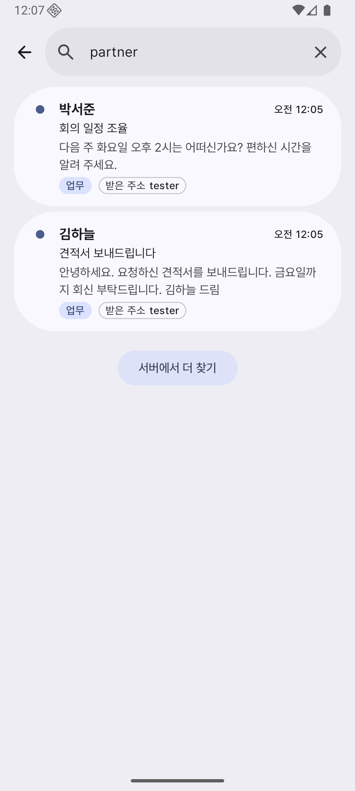
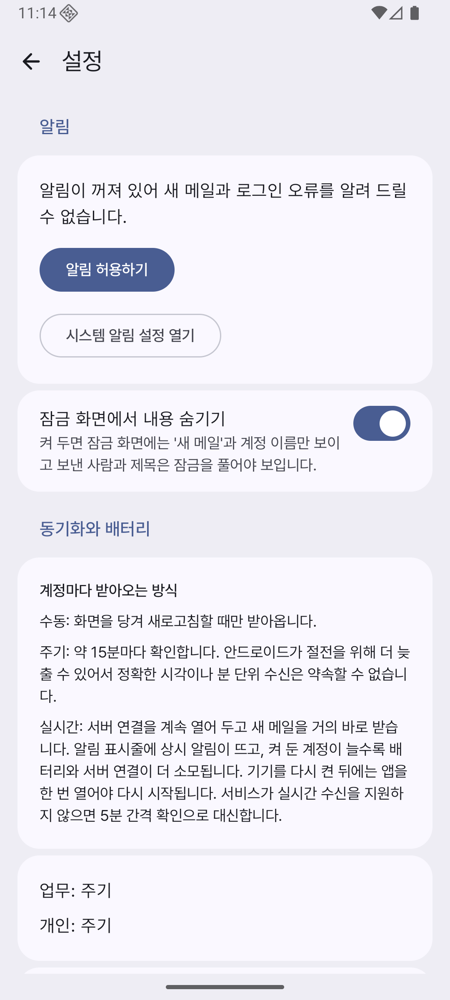

<p align="center">
  
</p>

<h1 align="center">Dustbird Mail</h1>

<p align="center">
  A personal multi-account mail app for Galaxy phones.<br>
  It talks to your mail servers directly over IMAP and SMTP, with an optional agent that keeps your inbox in order.
</p>

<p align="center">
  <a href="README.md">한국어</a> · <b>English</b>
</p>

<p align="center">
  
  
  
  
</p>
<p align="center">
  
  
  
  
</p>
<p align="center"><sub>All screenshots use sample data from a test server. The app UI is in Korean.</sub></p>

## Features

- **Search**: filters for date and time range, folder, account, field, unread, starred and attachments
- **Accounts**: iCloud Mail, Gmail, Naver Mail, Outlook Mail (Microsoft sign-in), and any IMAP/SMTP server. Add as many accounts and sender identities as you need.
- **Receiving**: unified inbox, manual, periodic (about every 15 minutes) and real-time (IMAP IDLE) sync, per-account notifications
- **Reading and tidying**: sanitized HTML with remote images blocked by default, swipe to archive or delete, multi-select, undo
- **Writing**: reply and forward, attachments, recipient suggestions, undo send, scheduled send, drafts
- **Agent**: finds, summarizes, drafts replies and tidies up, shows one-line summaries in the inbox and helps write mail in the composer. It is off by default, and every send needs your approval.
- **Security**: credentials encrypted with a per-account Android Keystore key, TLS-only connections, no analytics or ad SDKs

> [!NOTE]
> Real iCloud, Gmail, Naver and Outlook accounts have not been verified yet. Development and testing used a local test mail server only. The app is not on any store; you build it and install it on your own device.

## Build and install

You need JDK 21 or later, Android SDK platform 37, and a device running Android 12 (API 31) or later.

```sh
echo "sdk.dir=/path/to/Android/sdk" > local.properties
./gradlew :app:assembleDebug
adb install -r app/build/outputs/apk/debug/app-debug.apk
```

Run the tests and lint with the commands below. Device tests wipe the app's data, so run them on an emulator only. See the [detailed guide](docs/details.md#테스트와-실행-명령) (Korean) for more.

```sh
./gradlew :core:test
./gradlew :app:lintDebug
```

## Built with

Kotlin, Jetpack Compose, Material 3 Expressive, Room, WorkManager, DataStore, Jakarta Mail, jsoup, Pretendard

## Documentation

The documents below are written in Korean.

| Document | Contents |
| --- | --- |
| [Detailed guide](docs/details.md) | Verification status, full feature list, sync modes, security, known limits |
| [Agent design](docs/agent.md) | Connection methods, tools, approval rules, what was tested |
| [Technical decisions](docs/decisions.md) | Why each library and structure was chosen |
| [UI brief](docs/ui-brief.md) | The shadowless pill design |
| [Provider notes](docs/providers.md) | Confirmed and unconfirmed behavior per provider |
| [Real account checklist](docs/verification-checklist.md) | What to check with real accounts |

## License

Licensed under the [Apache License 2.0](LICENSE). The app logo and the Dustbird name are not covered by this license. License texts for the bundled font and libraries are in [`third_party/`](third_party/).
