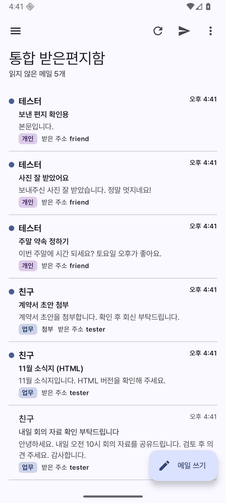
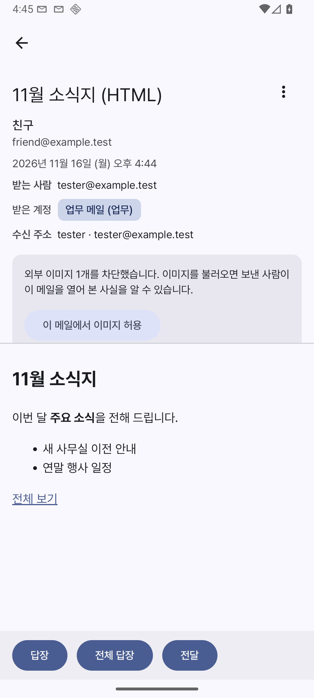
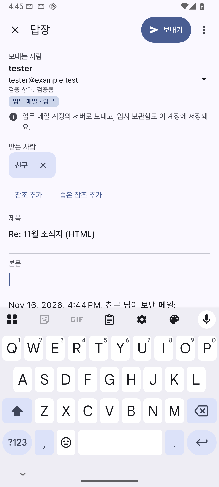
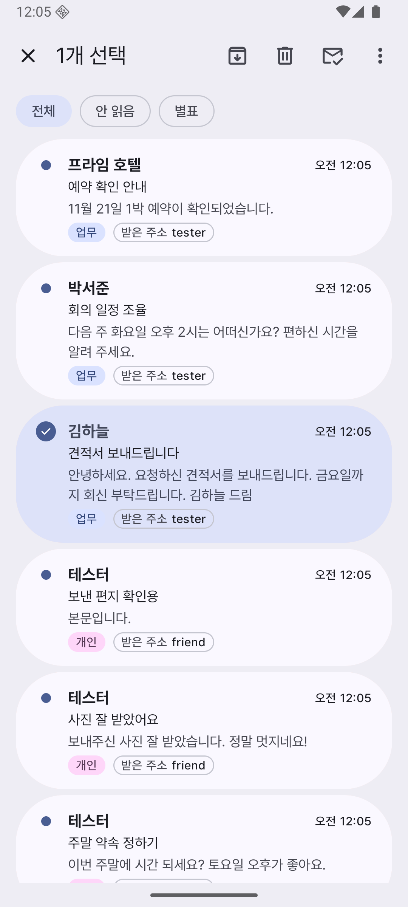
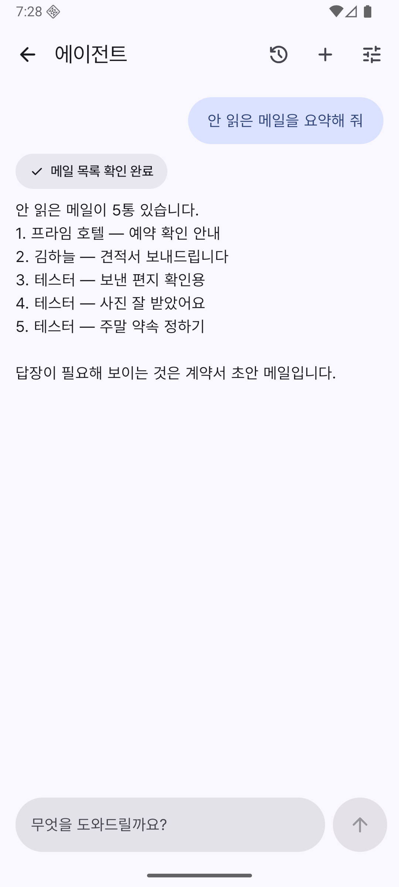
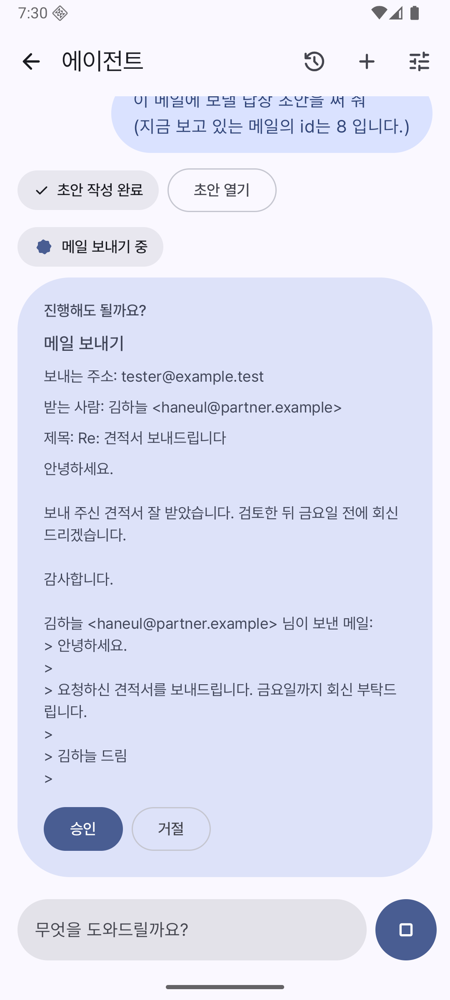
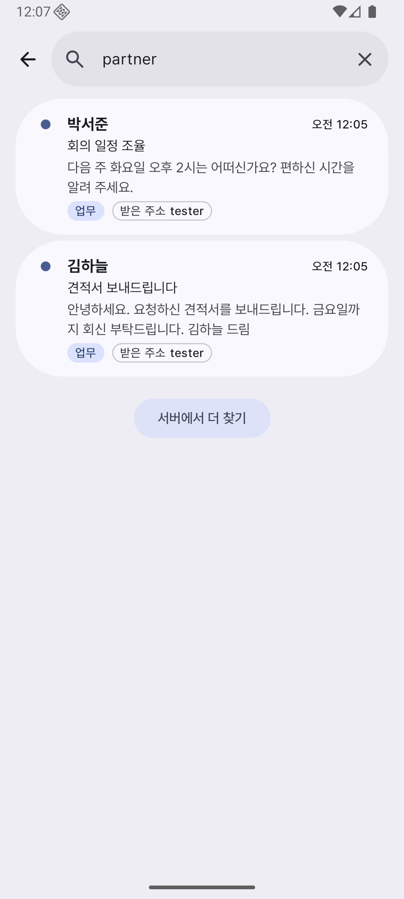
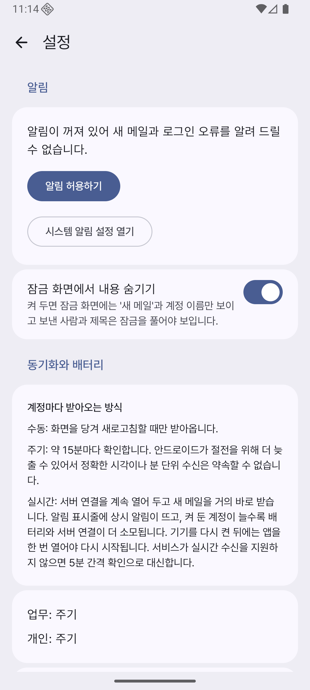

<p align="center">
  
</p>

<h1 align="center">Dustbird Mail</h1>

<p align="center">
  갤럭시에서 쓰는 개인용 다계정 메일 앱입니다.<br>
  IMAP과 SMTP로 메일 서버에 바로 연결하고, 원하면 메일을 대신 정리해 주는 에이전트를 켤 수 있습니다.
</p>

<p align="center">
  <b>한국어</b> · <a href="README.en.md">English</a>
</p>

<p align="center">
  
  
  
  
</p>
<p align="center">
  
  
  
  
</p>
<p align="center"><sub>모든 화면은 테스트 서버의 예시 데이터로 찍었습니다.</sub></p>

## 할 수 있는 것

- **계정**: iCloud 메일, Gmail, 네이버 메일, Outlook 메일(Microsoft 로그인), 직접 설정하는 IMAP과 SMTP. 계정과 발신 주소를 개수 제한 없이 추가합니다.
- **받기**: 통합 받은편지함, 에이전트가 쓴 한 줄 요약(켰을 때), 수동과 주기(약 15분)와 실시간(IMAP IDLE) 수신, 계정별 알림
- **읽기와 정리**: HTML 메일 정제와 외부 이미지 차단, 밀어서 보관과 삭제, 여러 통 선택, 실행 취소
- **찾기**: 기간(날짜와 시각), 폴더, 계정, 찾을 곳, 안 읽음, 별표, 첨부 필터
- **쓰기**: 에이전트와 쓰기(초안, 다듬기, 짧게, 맞춤법), 답장과 전달, 첨부, 받는 사람 추천, 보내기 취소, 예약 전송, 임시 저장
- **에이전트**: 메일 찾기, 요약, 답장 초안, 정리, 받은편지함 한 줄 요약, 메일 쓰기 도움. 기본으로 꺼져 있고, 메일을 보낼 때는 매번 사용자가 승인해야 합니다.
- **보안**: 계정마다 Android Keystore 키로 암호화한 자격 증명, TLS 연결만 허용, 분석과 광고 SDK 없음

> [!NOTE]
> 실제 iCloud, Gmail, 네이버, Outlook 계정으로는 아직 검증하지 않았습니다. 개발과 테스트는 테스트 메일 서버로만 했습니다. 스토어에는 올리지 않고 기기에 직접 설치해서 씁니다.

## 빌드와 설치

필요한 것은 JDK 21 이상, Android SDK 플랫폼 37, Android 12(API 31) 이상의 기기입니다.

```sh
echo "sdk.dir=/path/to/Android/sdk" > local.properties
./gradlew :app:assembleDebug
adb install -r app/build/outputs/apk/debug/app-debug.apk
```

테스트와 정적 점검은 아래 명령으로 돌립니다. 기기 테스트는 앱 데이터를 지우므로 에뮬레이터에서만 실행하세요. 자세한 방법은 [자세한 설명](docs/details.md#테스트와-실행-명령)에 있습니다.

```sh
./gradlew :core:test
./gradlew :app:lintDebug
```

## 사용한 기술

Kotlin, Jetpack Compose, Material 3 Expressive, Room, WorkManager, DataStore, Jakarta Mail, jsoup, Pretendard

## 문서

| 문서 | 내용 |
| --- | --- |
| [자세한 설명](docs/details.md) | 검증 현황, 기능 전체, 받아오는 방식, 보안, 알려진 제약 |
| [에이전트 설계](docs/agent.md) | 연결 방식, 도구, 승인 규칙, 확인 범위 |
| [기술 결정](docs/decisions.md) | 라이브러리와 구조를 고른 이유 |
| [화면 규칙](docs/ui-brief.md) | 그림자 없는 알약 모양 디자인 |
| [서비스별 확인 현황](docs/providers.md) | 서비스마다 확인한 동작과 확인하지 못한 동작 |
| [실제 계정 검증 점검표](docs/verification-checklist.md) | 실제 계정으로 확인할 항목 |

## 라이선스

[Apache License 2.0](LICENSE)을 따릅니다. 앱 로고와 Dustbird라는 이름은 이 라이선스에 포함되지 않습니다. 함께 쓰는 서체와 라이브러리의 라이선스 원문은 [`third_party/`](third_party/)에 있습니다.
