# 더스트버드 메일 자세한 설명

갤럭시 휴대폰에서 쓰는 개인용 다계정 메일 클라이언트입니다. Kotlin, Jetpack Compose, Material 3 Expressive, Material You(동적 색상)를 쓰고 서체는 Pretendard입니다. 화면은 그림자를 쓰지 않고, 메일은 알약 모양으로, 설정 화면은 조금 둥근 사각형 카드로 묶습니다. 모든 계정은 IMAP과 SMTP로 직접 연결하며 별도 서버를 거치지 않습니다. 스토어 배포는 범위 밖이고 사용자 본인 기기에 직접 설치합니다.

메일을 찾고 읽고 답장 초안을 쓰는 에이전트를 붙일 수 있습니다. 기본으로 꺼져 있고, 켜면 사용자가 고른 모델 서버(OpenAI API, ChatGPT 로그인, 직접 운영하는 OpenClaw나 Hermes 서버)로 메일 내용 일부가 전송됩니다. 보내기는 매번 사용자가 승인해야 합니다. 설계와 확인 범위는 [docs/agent.md](agent.md)에 있습니다.

지원 서비스는 iCloud 메일, Gmail, 네이버 메일, 직접 설정하는 IMAP과 SMTP 계정입니다. 같은 서비스의 계정을 여러 개 추가할 수 있고, 한 사서함에 연결된 발신 주소(Identity)를 여러 개 등록할 수 있습니다. 계정 수와 발신 주소 수는 코드나 스키마에 고정되어 있지 않습니다.

중요: 이 앱의 실제 계정 검증(iCloud, Gmail, 네이버)은 개발 중에 수행하지 않았습니다. 개발 중에는 테스트 서버만 썼고 외부로 메일을 보내지 않았습니다. 검증 절차는 [docs/verification-checklist.md](verification-checklist.md)에 있습니다.

## 검증 현황

2026년 11월 17일 기준, 실제로 실행한 결과입니다.

| 항목 | 결과 |
| --- | --- |
| `./gradlew :app:assembleDebug` | 성공. 디버그 APK 약 46MB |
| `./gradlew :core:test` | 154개 통과 |
| `./gradlew :app:testDebugUnitTest` | 29개 통과 |
| `./gradlew :app:lintDebug` | 오류 0건, 경고 1건(targetSdk 36을 의도적으로 유지) |
| `./gradlew :app:connectedDebugAndroidTest` | 144개 중 143개 통과, 실패 0건, 1건은 스크린샷용 시드 테스트라 건너뜀. 에뮬레이터(Android 36, arm64, 구글 API) |
| 실제 서비스 검증(iCloud, Gmail, 네이버) | 수행하지 않음. 서비스별로 따로 적습니다: iCloud 미수행, Gmail 미수행, 네이버 미수행 |
| 로그인 없이 실제 서버 8곳에 접속(TLS와 서버 이름 검증) | 통과(JVM 기본 신뢰 저장소 기준, `docs/providers.md`) |
| 릴리스 빌드(서명, 코드 축소) | 만들지 않았고 디버그 빌드만 만들어 실행했습니다 |
| 에뮬레이터에서 눈으로 확인한 것 | 아래 주요 화면에 실은 화면과 메뉴, 드로어(밝은 테마), 어두운 테마 3개 화면, 글자 크기 200% 3개 화면, 화면 크기를 바꿔 만든 넓은 화면 1개, 메일 화면의 접힌 머리글과 펼친 머리글(밝은 테마, 어두운 테마, 글자 크기 200%, 폭 360dp, 폴더블 크기의 두 칸 배치), 알림의 읽음과 보관과 삭제(비행기 모드에서 누른 삭제 포함), `mailto:` 주소 열기, 받는 사람 추천, 에이전트의 요약과 답장 승인과 거절(가짜 서버). 계정 추가의 준비 단계(밝은 테마, 어두운 테마, 글자 크기 200%)와 계정 정보, 로그인 확인 단계, 문장으로 입력하기(가짜 서버), 메일을 꾹 눌러 선택 모드로 들어가고 나오는 전환(화면 녹화를 프레임으로 나눠 확인), 더 보기 메뉴 네 곳(밝은 테마)과 메일 목록 메뉴(어두운 테마), 보내기 취소(남은 초 표시, 취소 뒤 다시 열림, 테스트 서버로 실제 발송), 예약 전송의 보낼 편지함 표시와 지금 보내기, 임시 저장한 메일 목록과 이어 쓰기, 에이전트 시작 화면(가짜 서버). 기능 점검(2026-11-17)에서 시험 메일로 확인한 것: EUC-KR과 ks_c_5601-1987과 ISO-2022-KR과 windows-1252 본문, 한글 이름 첨부의 열기(사진 앱)와 저장(시스템 파일 선택 창), 조작된 보낸 사람 이름에서 실제 주소 표시, 일반 글의 주소 누르기, 메일 속 메일 주소 링크로 작성 화면 열기, 첨부를 붙이고 글을 더 쓴 뒤 보낸 메일이 첨부와 함께 도착, 검색어 유지, 새 폴더를 열자마자 받아오기, 메일 화면 삭제 뒤 실행 취소, 알림 권한 요청 창, 실시간 수신 알림과 읽은 메일의 알림 지우기, 첨부가 있는 메일의 전달이 첨부와 함께 도착, 시스템 파일 앱의 공유 창에서 넘긴 파일이 작성 화면에 첨부됨. 계정 추가의 메일함 불러오기와 폴더 확인 단계, 자동 실행 편집 창, 폴더 고르기 창은 마지막 변경 뒤에 다시 보지 않았습니다 |
| 에이전트의 실제 서버 연결(OpenAI API, ChatGPT 로그인, OpenClaw, Hermes) | ChatGPT 로그인은 실제 서버에서 기기 코드 발급과 승인 대기 응답까지만 확인. 로그인 완료와 실제 모델 요청, 나머지 방식은 수행하지 않음(가짜 서버로만 확인) |
| 갤럭시 실기기, 실제 폴더블, TalkBack, 입력기 동작, 보내기 실패 알림, 본문에만 있는 낱말의 서버 검색, Gmail의 전체 메일 폴더, 받은 메일을 모두 옮긴 뒤 이전 메일 불러오기(단위 테스트로만 확인), 120Hz 화면에서의 주사율(에뮬레이터는 60Hz) | 확인하지 못함 |

기기 테스트에는 테스트 서버를 실제 IMAP과 SMTP 코드로 거쳐서 보내기, 받기, 답장 연결, 읽음 동기화, 별표, 보관, 삭제와 실행 취소, 검색, 첨부 보내기와 받기, 답장함 표시, 한 계정 인증 실패 격리, 초안 이동, 실시간 수신(IDLE) 알림, 알림 내용과 버튼과 잠금 화면 처리, 자격 증명 보관과 삭제가 들어 있습니다. 에이전트는 기기 안의 가짜 서버로 요청 형식, 도구 실행, 승인 규칙, 로그인 절차의 형식, 계정 정보 채우기의 값 검사를 확인합니다. 테스트 서버 결과는 실제 서비스 검증이 아닙니다.

## 기능

| 영역 | 들어 있는 것 |
| --- | --- |
| 계정 | iCloud, Gmail, 네이버, 직접 설정. 계정 여러 개, 발신 주소 여러 개, 서명, 폴더 역할 확인, 단계별 연결 점검 |
| 받기 | 통합 받은편지함, 계정별 보기와 폴더별 보기, 수동과 주기와 실시간 수신, 이전 메일 더 보기, 안 읽음과 별표 필터 |
| 읽기 | 일반 글(주소 누르기)과 HTML(정제, 외부 이미지 기본 차단, 링크 확인 창), 첨부 열기와 저장, 일정 초대와 첨부된 메일을 첨부로 열기 |
| 정리 | 읽음과 안 읽음, 별표, 보관, 삭제(휴지통), 스팸 신고, 폴더 이동, 여러 통 선택, 밀어서 보관과 삭제, 실행 취소 |
| 찾기 | 기기에 받아 둔 메일 검색, 서버에서 더 찾기(본문 포함) |
| 쓰기 | 새 메일, 답장, 전체 답장, 전달(원본 첨부 포함), 파일 첨부, 받는 사람 추천, 초안 저장과 임시 저장한 메일 이어 쓰기, 보내기 취소 시간(기본 5초), 예약 전송, 보낼 편지함과 다시 시도, `mailto:` 주소와 다른 앱의 공유 받기 |
| 알림 | 계정별 알림 채널, 잠금 화면 내용 숨김, 알림에서 읽음과 보관과 삭제, 읽은 메일의 알림 지우기, 보내기 실패 알림 |
| 에이전트 | 메일 관리자 역할(찾기, 요약, 답장 초안, 정리), 대화로 맡기기, 메일 화면에서 맡기기, 도구 11개, 승인 화면, 기억, 새 메일과 매일 정해진 시각의 자동 실행, 활동 기록, 계정 추가에서 문장으로 입력하기 |

## 주요 화면

모든 스크린샷은 테스트 서버의 예시 데이터이며 실제 주소나 메일이 아닙니다. 에뮬레이터 기본 동적 색상입니다. 에이전트 대화와 보내기 승인 화면은 정해진 답만 돌려주는 가짜 서버에 붙여서 찍었고, 에이전트 설정 화면은 연결하기 전의 기본 상태입니다.

| 통합 받은편지함 | HTML 메일 | 답장 작성 |
| --- | --- | --- |
| 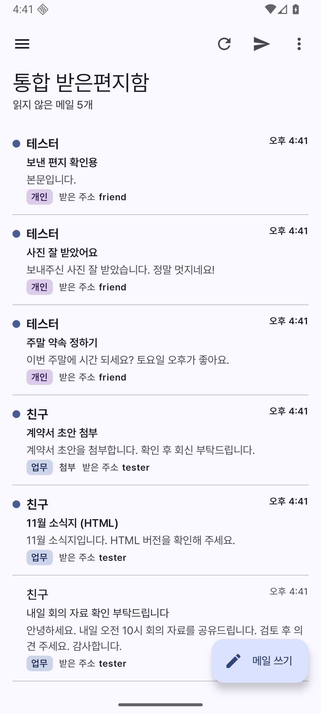 | 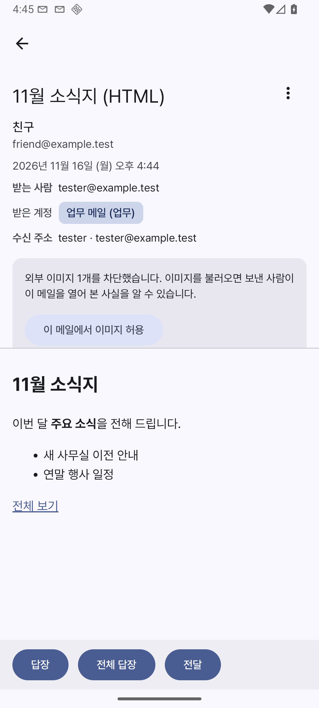 | 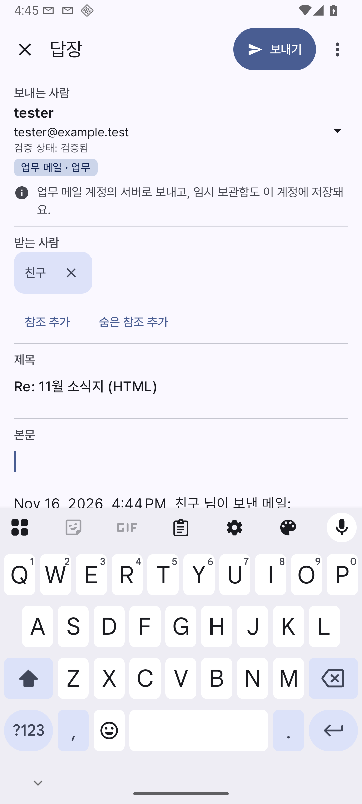 |

| 여러 통 선택 | 검색 | 보낼 편지함 |
| --- | --- | --- |
| 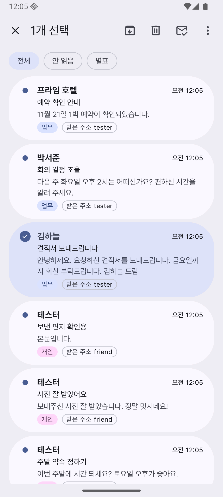 | 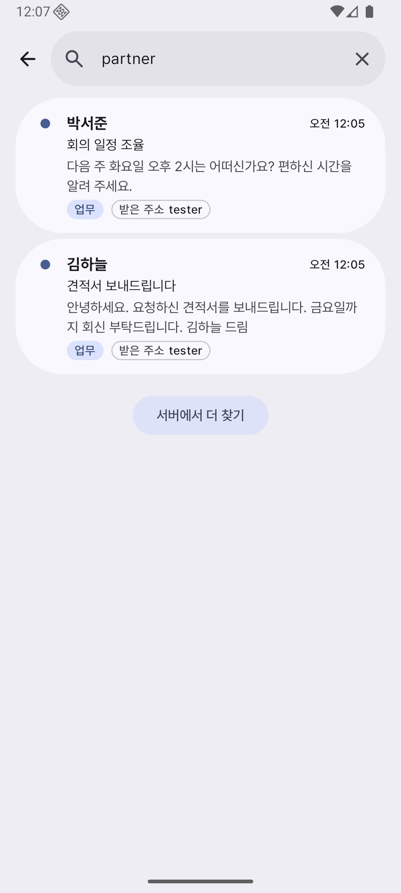 | 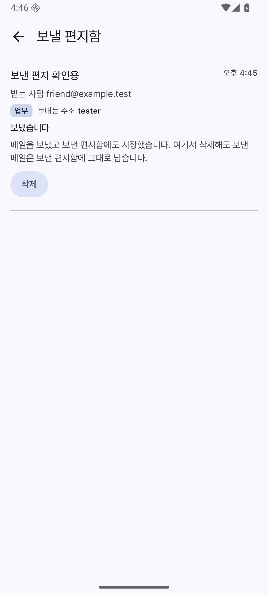 |

| 에이전트 대화 | 보내기 승인 | 에이전트 설정 |
| --- | --- | --- |
| 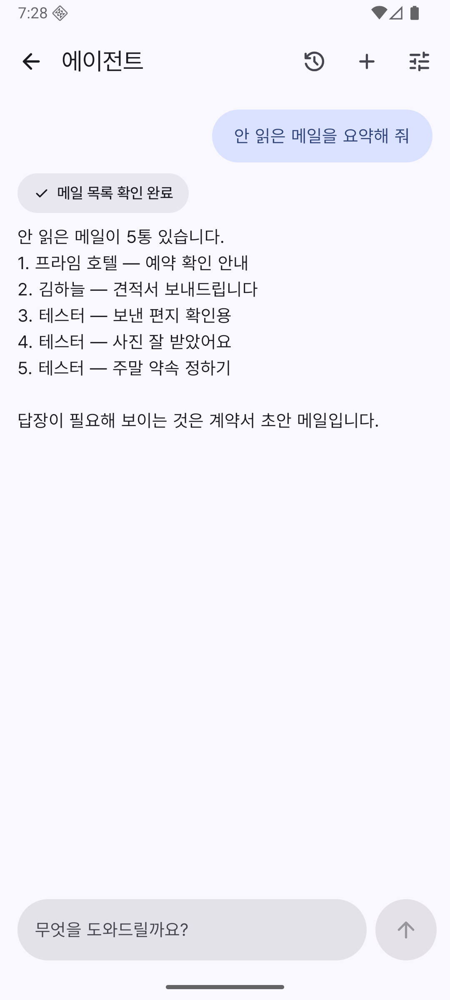 | 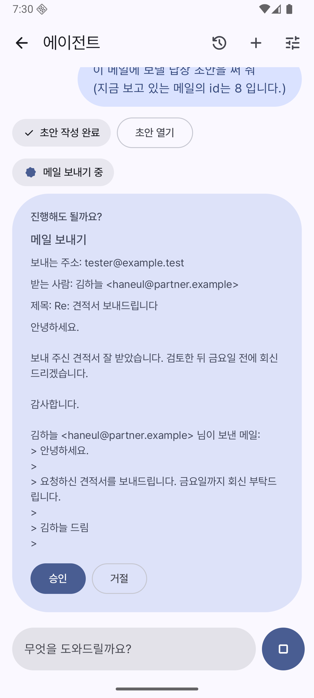 | 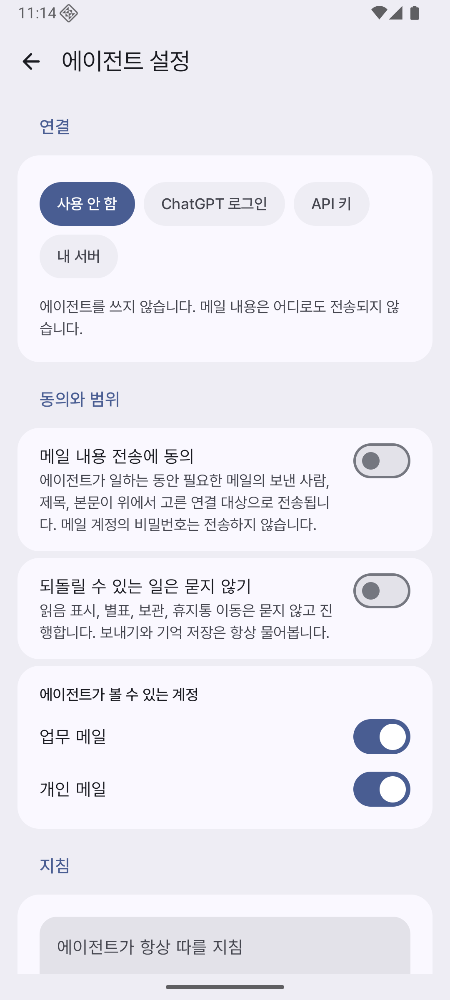 |

| 계정 목록 | 계정 상세 | 설정 |
| --- | --- | --- |
| 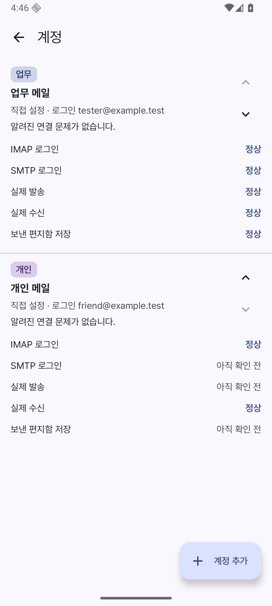 | 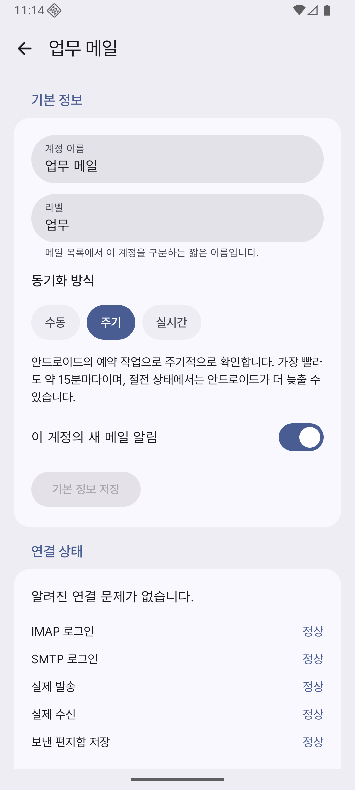 | 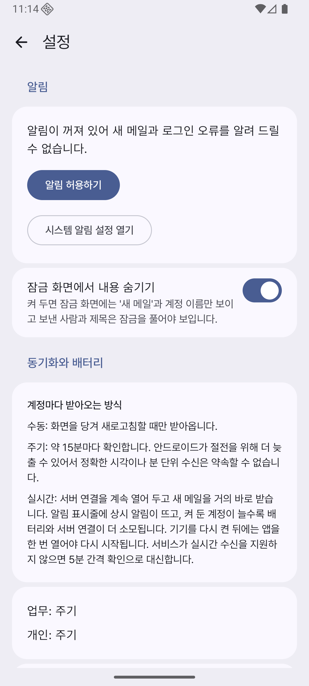 |

| 계정 추가 준비 | 넓은 화면(에뮬레이터 화면 크기를 바꿔서 확인) |
| --- | --- |
| 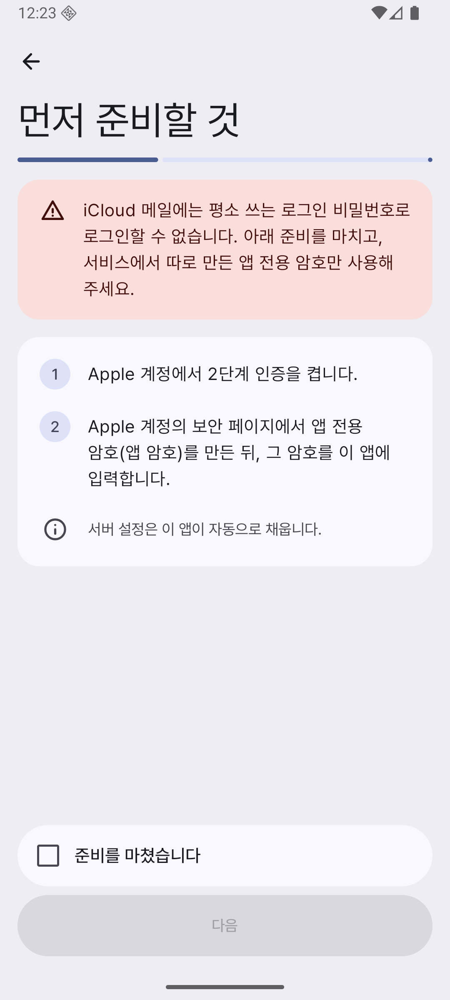 | 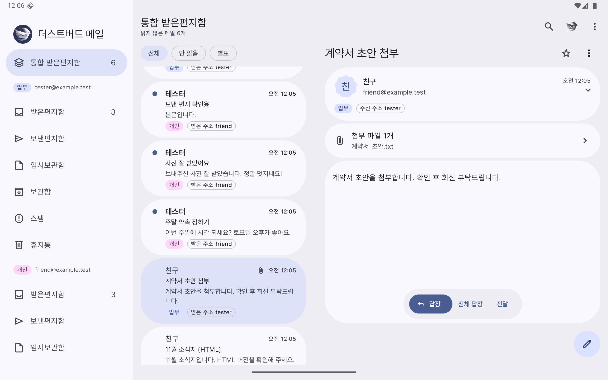 |

## 구성

| 위치 | 내용 |
| --- | --- |
| `core/` | JVM 전용. 서비스 프로필, 계정과 발신 주소 규칙, 수신 주소 판별, 답장 규칙, MIME, 폴더 역할, 발송 상태 기계, 폴더 동기화, HTML 정제, IMAP과 SMTP 게이트웨이 |
| `app/` | Android. Room, 자격 증명 보관, 리포지토리, 동기화와 발송 서비스, 알림, 백그라운드 작업, 화면 |
| `testfixtures/` | 테스트 전용 TLS 인증서(보호할 비밀이 없는 일회용 키) |
| `third_party/` | 서체와 의존성 라이선스 원문 |
| `docs/` | 기술 결정 기록, 에이전트 설계, 화면 규칙, 서비스별 확인 현황, 실제 서비스 검증 점검표 |

- 기술 결정과 근거: [docs/decisions.md](decisions.md)
- 에이전트 설계와 확인 범위: [docs/agent.md](agent.md)
- 화면 규칙(그림자 없는 알약 모양): [docs/ui-brief.md](ui-brief.md)
- 서비스 프로필별 확인된 동작과 미확인 동작: [docs/providers.md](providers.md)
- 서비스별 실제 계정 검증 점검표: [docs/verification-checklist.md](verification-checklist.md)

## 요구 사항

- JDK 21 이상(개발은 21로 했습니다)
- Android SDK: 플랫폼 37(compileSdk), 빌드 도구, 에뮬레이터를 쓰려면 Android 36 시스템 이미지
- Gradle은 래퍼(9.7.0)를 씁니다. 인터넷 연결이 필요합니다(Maven Central, Google Maven).
- 대상 기기: Android 12(API 31) 이상의 갤럭시. targetSdk는 36입니다.

## 설정과 빌드

저장소 루트에 `local.properties`를 만들어 SDK 위치를 적습니다(저장소에는 올라가지 않습니다).

```
sdk.dir=/path/to/Android/sdk
```

디버그 APK 만들기

```
./gradlew :app:assembleDebug
```

결과물은 `app/build/outputs/apk/debug/app-debug.apk`이며 서명 키는 필요하지 않습니다(디버그 키 사용). 기기에 `adb install -r app/build/outputs/apk/debug/app-debug.apk`로 설치합니다. 릴리스 서명 키와 로컬 설정 파일은 저장소에 포함하지 않습니다.

## 테스트와 실행 명령

| 목적 | 명령 |
| --- | --- |
| 코어 단위 테스트와 통합 테스트(GreenMail, 스크립트 SMTP 서버) | `./gradlew :core:test` |
| 정적 점검 | `./gradlew :app:lintDebug` |
| 기기 테스트용 서버 실행(다른 터미널에서 계속 켜 둠) | `./gradlew :core:runTestServer` |
| 에뮬레이터 또는 기기 테스트 | `./gradlew :app:connectedDebugAndroidTest` |

주의: 기기 테스트는 앱의 실제 데이터(계정, 메일 캐시, 설정)를 지우고, 일부 테스트는 실제 기기 보안 저장소에 계정 번호 1, 2 같은 이름의 키와 파일을 만듭니다. 실사용 중인 기기에서는 실행하지 말고 에뮬레이터나 시험용 기기에서만 실행하세요.

기기 테스트 중 종단 테스트(`EngineEndToEndTest`, `MailActionsEndToEndTest`)는 호스트의 테스트 서버(에뮬레이터에서 `10.0.2.2:3993`과 `3465`)가 켜져 있어야 하며, 없으면 건너뜁니다. 디버그 빌드는 `10.0.2.2` 한 곳에 대해서만 테스트용 인증서를 신뢰하고 릴리스 빌드에는 그 설정이 없습니다. 테스트 서버 검증 결과는 실제 서비스 검증이 아닙니다. 에이전트 테스트는 기기 안에서 띄우는 가짜 서버만 쓰므로 호스트 서버도 외부 연결도 필요하지 않습니다.

## 받아오는 방식과 실제 지연

계정마다 세 가지 중에서 고릅니다. 지연 범위는 설정 화면에도 같은 내용으로 적혀 있습니다.

- 수동: 새로고침할 때만 받아옵니다.
- 주기: WorkManager로 약 15분마다. 안드로이드와 삼성의 절전이 더 늦출 수 있어서 즉시 수신이나 분 단위 정확도는 약속하지 않습니다.
- 실시간: IMAP IDLE 연결을 포그라운드 서비스로 유지해 거의 즉시 받습니다. 상시 알림이 보이고, 켠 계정이 늘수록 배터리와 서버 연결이 늘어납니다. 서버가 IDLE을 광고하지 않으면 5분 간격 확인으로 대신합니다. 기기를 다시 켜거나 강제 종료한 뒤에는 앱을 한 번 열어야 다시 시작됩니다.

배터리 최적화 예외는 앱이 임의로 요청하지 않습니다. 설정 화면에서 이유를 설명하고 사용자가 시스템 화면에서 직접 선택합니다.

## 발신 주소 검증과 원문 헤더 확인

앱에 주소를 추가하는 것과 서버가 그 주소의 발송을 허용하는 것은 별개입니다. 발신 주소마다 상태(미검증, 검증됨, 실패)가 있고, 계정 상세 화면의 "시험 발송"(사용자가 확인 창에서 승인해야만 보냅니다)이나 실제 발송으로 확인됩니다.

서버가 From이나 envelope sender를 바꿔 쓸 수 있으므로 수동 확인이 필요합니다.

1. 해당 발신 주소로 자기 자신(다른 서비스의 주소가 더 좋습니다)에게 시험 발송합니다.
2. 받은 메일의 원문(헤더 보기)을 엽니다.
3. `From:`이 선택한 발신 주소와 같은지 확인합니다.
4. `Return-Path:`와 가능하면 `Received:`의 envelope 주소를 확인해 서버가 어느 주소로 바꿔 보냈는지 기록합니다.
5. 로그인 이름은 발신 주소를 바꿔도 바뀌지 않습니다.

## 보안 요약

- 암호는 사용자가 앱 안에서 입력합니다. 소스, 리소스, 빌드 설정, 테스트 데이터, 문서에 실제 주소와 암호가 없습니다.
- 계정마다 별도 Keystore AES-256-GCM 키로 암호화해서 `noBackupFilesDir`에 저장하고, 클라우드 백업과 기기 간 전송에서 제외합니다.
- 모든 연결은 TLS 또는 STARTTLS이며 암호화 없는 선택지는 없습니다. 서버 이름 검증은 명시적으로 켜져 있고, STARTTLS를 제공하지 않는 서버는 거부하며, 인증서 검증을 우회하는 설정은 제품 코드에 없습니다.
- 로그, 분석, 원격 보고에 암호, 토큰, 메일 본문, 주소를 남기지 않습니다. 분석과 광고와 원격 로깅 SDK가 없고, 프로토콜 디버그 출력은 켜지 않습니다.
- HTML 메일은 정제, JavaScript 차단, 콘텐츠 보안 정책, 외부 이미지 기본 차단, 링크 확인 창으로 다룹니다.
- 계정을 삭제하면 그 계정의 자격 증명, 캐시, 발송 대기 항목, 알림 기록만 지웁니다. 설정 화면에서 전체 초기화도 할 수 있습니다.
- 받은 첨부는 앱 캐시에 두고 다른 앱에는 그 파일 하나의 읽기 권한만 줍니다. 파일 이름의 경로 문자는 바꿔 씁니다. 보낼 첨부는 `content://` 주소만 받습니다.
- 다른 앱이 넘긴 `mailto:` 주소와 공유 내용은 작성 화면에 채워 보여 줄 뿐 자동으로 보내지 않습니다.
- 보낸 사람은 머리글의 실제 주소로 표시합니다. 표시 이름에 다른 메일 주소가 들어 있으면 이름을 버리고 실제 주소만 보여 줍니다(이름으로 다른 주소인 척하는 메일 대비).
- 에이전트는 사용자가 연결 방식을 고르고 전송에 동의해야 동작합니다. 메일 본문은 신뢰하지 않는 입력으로 표시해서 넘기고, 보내기와 기억 저장은 매번 승인을 받으며, 사람이 없는 자동 실행에서는 둘 다 할 수 없습니다. 에이전트는 메일을 영구 삭제하지 못하고, 막아 둔 계정은 볼 수 없습니다. API 키와 로그인 토큰은 계정 암호와 같은 방식으로 암호화해 둡니다.
- 계정 추가의 문장 입력은 사용자가 적은 글만 모델로 보냅니다. 모델이 돌려준 값은 양식 규칙으로 다시 검사하고, 비밀번호는 모델이 채울 수 없으며, 로그인 확인과 계정 추가는 사용자가 직접 눌러야 진행됩니다.
- 평문 HTTP는 같은 기기 안의 주소(`127.0.0.1`, `localhost`)에만 허용합니다. 기기 안에서 도는 에이전트 서버에 필요합니다.

## 알려진 제약과 후속 작업

- 대화(스레드)로 묶어 보기, 수신 거부 머리글 버튼, 휴지통 비우기, 폴더 만들기와 이름 바꾸기와 지우기, 계정 간 메일 이동, 주소록 연동, 인쇄, 원문과 머리글 보기, 이전과 다음 메일로 넘기기, 첨부 공유, 서식 있는 글 쓰기, 테마와 밀기 동작 설정은 없습니다.
- 휴지통과 보관함 역할은 서버가 알려 주는 속성으로만 정해지고 직접 고르는 화면이 없습니다. 속성을 주지 않는 서버에서는 삭제가 영구 삭제(확인 창)가 되고 보관을 쓸 수 없습니다.
- 일정 초대와 첨부된 메일은 첨부(`invite.ics`, `message.eml`)로만 열 수 있고 앱 안에서 보거나 답하지 못합니다.
- 보내지 못한 메일은 다시 시도와 삭제만 됩니다. 내용을 고쳐 다시 보내려면 새로 써야 합니다(메일을 만들다 실패한 경우만 "취소하고 고치기"가 됩니다).
- 서버에서 지워지거나 다른 기기에서 읽은 메일을 기기에 반영하는 범위는 폴더마다 최신 500통입니다. 열어 본 적 없는 메일의 본문은 오프라인에서 읽을 수 없습니다.
- 예약 전송은 이 기기가 그 시각에 직접 보냅니다. 정확한 알람 권한을 쓰지 않아서 절전 상태에서는 몇 분 늦을 수 있고, 그때 인터넷이 없으면 연결된 뒤에 보냅니다. 기기가 꺼져 있으면 켜진 뒤에 보냅니다. 보내지 못하면 알림으로 알리고 보낼 편지함에 표시합니다.
- 다른 기기에서 저장한 초안(서버의 임시보관함에만 있는 것)은 읽기 화면으로 열리고 이어 쓸 수 없습니다.
- 보낼 첨부는 합계 15MB까지입니다. 받은 메일의 본문 속 이미지(cid 참조)는 본문에 보이지 않고 첨부 목록에서 열 수 있습니다.
- 검색은 기기에 받아 둔 메일의 보낸 사람, 받는 사람, 제목, 미리보기에서 찾고, 본문 전체는 "서버에서 더 찾기"로 찾습니다. 서버 검색은 계정마다 받은편지함, 보관함(없으면 전체 메일), 보낸편지함에서 폴더마다 50통까지 가져옵니다. 테스트 서버가 본문 검색을 지원하지 않아 본문 일치는 실제 서버로 확인해야 합니다.
- 보관과 삭제는 실행 취소 버튼이 보이는 동안(약 4초) 되돌릴 수 있고 그 뒤 서버에 반영합니다. 그 사이 앱이 종료되면 반영되지 않고 메일이 목록에 다시 보입니다.
- 앱은 화면이 지원하는 가장 높은 주사율을 요청합니다. 기기에서 60Hz로 고정했거나 절전 모드이면 시스템이 따르지 않을 수 있고, 높은 주사율을 유지하는 만큼 배터리를 더 쓸 수 있습니다. 120Hz 기기에서는 확인하지 못했습니다.
- 알림에서 누른 보관과 삭제는 네트워크가 연결되면 실행하고, 세 번 실패하면 메일이 받은편지함에 그대로 남습니다. 휴지통이나 보관 폴더가 없는 계정은 알림에서 처리하지 못합니다.
- 에이전트의 ChatGPT 로그인은 Codex 기기 코드 방식(앱이 보여 주는 코드를 Codex 웹에 입력)이며 OpenClaw와 Hermes가 쓰는 방식과 같습니다. OpenAI가 다른 앱용으로 문서화한 경로가 아니어서 정책이나 형식이 바뀌면 동작하지 않을 수 있습니다. 실제 서버로는 코드 발급과 승인 대기까지만 확인했고, 로그인 완료와 실제 모델 요청, API 키 방식, OpenClaw와 Hermes 서버는 확인하지 못했습니다. 자세한 내용은 `docs/agent.md` 1절과 7절에 있습니다.
- 데이터베이스는 3판입니다. 1판과 2판에서 올리는 자동 마이그레이션은 최종 모양으로는 시험하지 않았습니다.
- 토큰 인증(OAuth)은 구현하지 않았습니다. 인증 방식은 계정 모델에서 분리되어 있어(`AuthMethod`) 나중에 붙일 수 있습니다. Gmail에서 필요하다고 판단되면 다음을 준비해야 합니다. 조사 결과(구글 공식 문서 확인): 본인의 Google Cloud 프로젝트와 OAuth 클라이언트 ID가 필요합니다. 동의 화면의 게시 상태가 "테스트"인 외부 사용자 유형 프로젝트는 갱신 토큰이 7일 뒤 만료되며(이름, 이메일, 프로필 범위만 요청할 때만 예외), 메일 전체 접근 범위는 이 예외에 해당하지 않아서 7일마다 다시 동의해야 합니다. 공식 문서상 개발 중인 앱과 개인 시험용은 검증이 필요 없다고 되어 있으나 검증되지 않은 앱은 경고 화면과 사용자 100명 제한이 따라붙습니다. 메일 전체 접근 범위를 제한 범위로 분류한다는 점은 공식 문서의 범위 표에서 직접 확인하지 못했습니다(가정). 그래서 1차 구현의 Gmail 기본 경로는 앱 비밀번호입니다. 앱 비밀번호를 만들 수 없는 계정(회사, 학교, 보안 키 전용, 고급 보호)은 이 앱으로 연결할 수 없습니다.
- Gmail의 점과 `+` 별칭처럼 서비스가 같은 사서함으로 취급하는 주소 변형은 중복 등록을 막지 못합니다.
- 메일 목록의 첨부 표시는 머리글(`multipart/mixed`)과 앞부분 16KB로 추정하고, 상세 화면에서 정확한 목록을 보여 줍니다.
- 한 번에 가져오는 처음 페이지는 계정과 폴더마다 최신 50통이며 이전 메일은 "더 보기"로 불러옵니다.
- 서비스별 보낸 편지함 자동 저장, 전달 헤더, 폴더 속성 같은 동작은 `docs/providers.md`의 미확인 항목을 실제 계정으로 확인한 뒤 프로필 값을 고쳐야 합니다.
- 실시간 서비스는 앱이 화면에 있을 때만 시작할 수 있는 안드로이드 제약이 있습니다.
- 계정 하나에 로그인 이름이 하나뿐이라 IMAP과 SMTP가 같은 이름을 씁니다. Apple 문서처럼 IMAP은 주소 앞부분, SMTP는 전체 주소가 필요한 경우는 지원하지 못합니다(이전 클라이언트에서는 전체 주소로 동작했습니다).
- 메일 상세에서 화면을 회전하면 스크롤 위치가 처음으로 돌아가고 링크 확인 창이 닫힙니다. HTML 메일을 열 때마다 내장 서체 6.7MB를 읽습니다.
- 계정 추가 첫 화면에서 시스템 뒤로 가기를 누르면 앱이 종료됩니다(돌아갈 곳이 없기 때문). 실기기에서의 동작은 확인하지 못했습니다.
- 서버가 BODYSTRUCTURE를 라이브러리가 읽지 못하는 형태로 돌려주면 본문을 지연해서 읽을 수 없어서 메일 전체를 받아 해석합니다(테스트 서버에서 겪었고 대체 경로를 만들었습니다).
- 시스템 언어가 한국어가 아니면 답장 인용문의 날짜가 시스템 언어 형식으로 나옵니다.
- 인코딩 표시 없이 EUC-KR 바이트로 온 제목과 보낸 사람 이름은 깨져 보입니다(본문은 정상). 실시간 수신의 재접속은 기기가 깊이 잠들면 늦어질 수 있습니다.

## 알파, 베타, 릴리스 후보 의존성

- `androidx.compose.material3:material3:1.5.0-rc01`(릴리스 후보): Expressive 컴포넌트가 이 계열에만 있습니다. 이유와 되돌리는 방법은 `docs/decisions.md` 4절에 있습니다.
- 그 밖의 의존성은 모두 안정판입니다(AGP 9.5.1, Kotlin 2.4.21, KSP 2.3.14, Room 2.8.5, WorkManager 2.12.0, DataStore 1.3.0, Navigation Compose 2.10.2, Lifecycle 2.11.0, Compose BOM 2026.09.00, Material3 adaptive 1.3.0, android-mail 1.6.8, jsoup 1.24.1).

## 오픈소스 고지

Pretendard(SIL OFL 1.1), Jakarta Mail과 Activation의 Android 배포판(EPL 2.0, GPL 2.0 클래스패스 예외), jsoup(MIT), AndroidX와 Kotlin(Apache 2.0), Material Symbols 아이콘(Apache 2.0)을 사용합니다. 원문은 [`third_party/`](../third_party/)와 앱의 설정 화면 오픈소스 고지에 있습니다.
